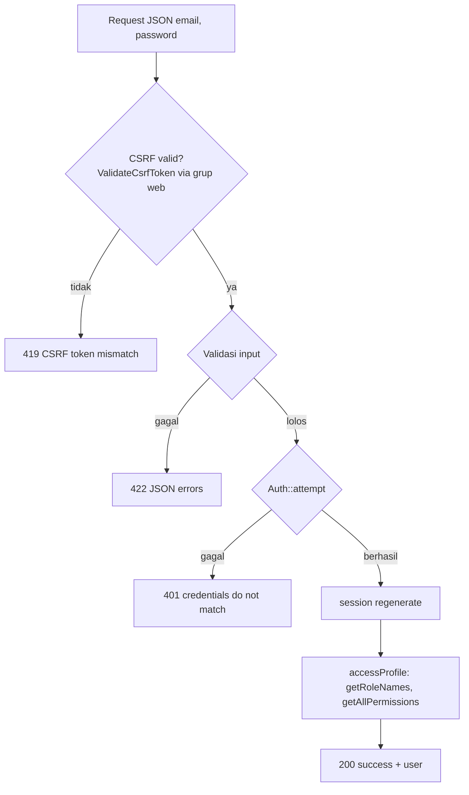

# Arsitektur Backend dan API

> Diverifikasi terhadap kode dan `php artisan route:list` pada 2026-10-30.

## 1. Komponen Aktual

| Lapisan | Isi | Status |
|---|---|---|
| Framework | Laravel 13.38.0; `composer.json` mensyaratkan PHP `^8.3` | `IMPLEMENTED` |
| Paket utama | `laravel/sanctum ~4.0`, `spatie/laravel-permission ^8.3`, `laravel/tinker` | `IMPLEMENTED` (terpasang) |
| Paket dev | `larastan/larastan ~3.0`, `laravel/pint`, `phpunit ^12.5`, `laravel/pail`, `laravel/pao`, `mockery`, `collision`, `faker` | Terpasang |
| Controller | `Api\V1\AuthController`, `Api\V1\HealthController` | `IMPLEMENTED` |
| Model | `User` saja | `IMPLEMENTED` |
| Middleware | `SecurityHeadersMiddleware` (global, `append`) + alias `role`, `permission`, `role_or_permission` (Spatie) | `IMPLEMENTED` (alias belum dipakai di route mana pun) |
| Repository | `BaseRepository`, `RepositoryInterface` | Ada, **tidak dipakai** |
| Form Request, Policy, Gate, Service, Event, Listener, Job, Notification, Observer, Enum | Tidak ada | `NOT IMPLEMENTED` |
| Seeder | `DatabaseSeeder` bawaan; tidak membuat role/user | Tidak memadai |

Konvensi yang diambil dari proyek suntrack-mysql (arsitektur saja, bukan kode bisnis): controller API di `App\Http\Controllers\Api\V1`, respons lewat trait `ApiResponse`, akses data lewat repository, otorisasi lewat Spatie + Policy, analisis statis Larastan.

## 2. Daftar Endpoint

| Method | Path | Middleware | Handler | Fungsi |
|---|---|---|---|---|
| GET | `/api/v1/health` | `api` | `HealthController@check` | Cek koneksi DB dan baca/tulis cache. 200 jika sehat, 503 jika DB gagal |
| GET | `/sanctum/csrf-cookie` | `web` | Sanctum `CsrfCookieController` | Set cookie `XSRF-TOKEN` |
| POST | `/api/v1/auth/login` | `api`, `web` | `AuthController@login` | Validasi `email` (required, email, max 255) dan `password`; `Auth::attempt`; regenerasi sesi |
| POST | `/api/v1/auth/logout` | `api`, `web`, `auth:sanctum` | `AuthController@logout` | Logout guard web, invalidasi sesi, regenerasi token |
| GET | `/api/v1/auth/user` | `api`, `web`, `auth:sanctum` | `AuthController@user` | Profil: id, name, email, role, roles, permissions |
| GET | `/up` | — | Bawaan Laravel | Health check framework |
| GET, PUT | `/storage/{path}` | — | Bawaan Laravel (`serve => true` pada disk `local`) | Melayani/menerima file disk lokal lewat URL bertanda tangan (temporary URL). Belum dipakai aplikasi |
| GET | `/{any}` | `web` | Closure | Shell SPA untuk semua path lain |

## 3. Alur Request per Endpoint

### `POST /api/v1/auth/login`

Belum ada pembatasan percobaan login (rate limit). Lihat SEC-01.

### `GET /api/v1/health`

Menjalankan `DB::connection()->getPdo()` dan `Cache::put/get`. Pesan exception DB dan cache dimasukkan ke respons (`'error: '.$e->getMessage()`), dan respons mencantumkan `environment`. Endpoint ini publik. Lihat SEC-04.

## 4. Penanganan Error

`bootstrap/app.php`:

- `shouldRenderJsonWhen` untuk `api/*`.
- `AuthenticationException` → 401 `{success:false, message:'Unauthenticated.', errors:[]}`.
- `AuthorizationException` dan `Spatie\Permission\Exceptions\UnauthorizedException` → 403 dengan format yang sama.
- Exception lain mengikuti handler Laravel. Saat `APP_DEBUG=true`, respons JSON memuat kelas exception dan stack trace (diverifikasi: 419 CSRF di lokal menampilkan `exception` dan trace).

## 5. Sesi, Cache, Queue

- `SESSION_DRIVER=database`, `CACHE_STORE=database`, `QUEUE_CONNECTION=database` (default `.env.example`).
- Tidak ada job aplikasi. Service `queue` di Docker hanya menjalankan worker kosong.
- Tidak ada scheduler (`routes/console.php` bawaan).

## 6. Rencana Backend (`PROPOSED`)

Arsitektur modul e-commerce yang diusulkan ada di [PROPOSED_DOMAIN_ARCHITECTURE.md](PROPOSED_DOMAIN_ARCHITECTURE.md). Prinsip: modular monolith (PRD v0.1), service untuk logika bisnis (checkout, alokasi gudang, pembayaran, pengiriman), Form Request untuk validasi, Policy + permission Spatie untuk otorisasi, transaksi database untuk stok/order.
