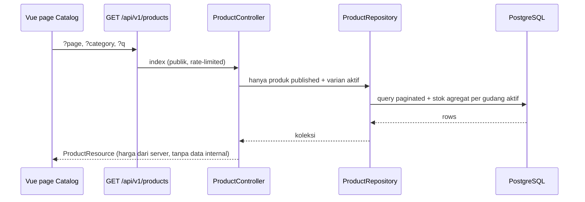
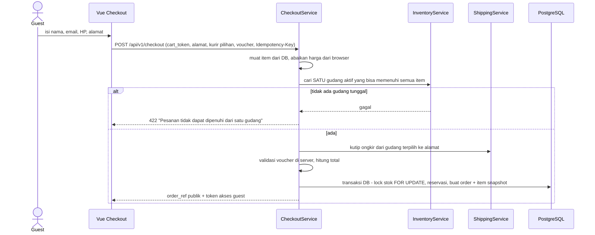
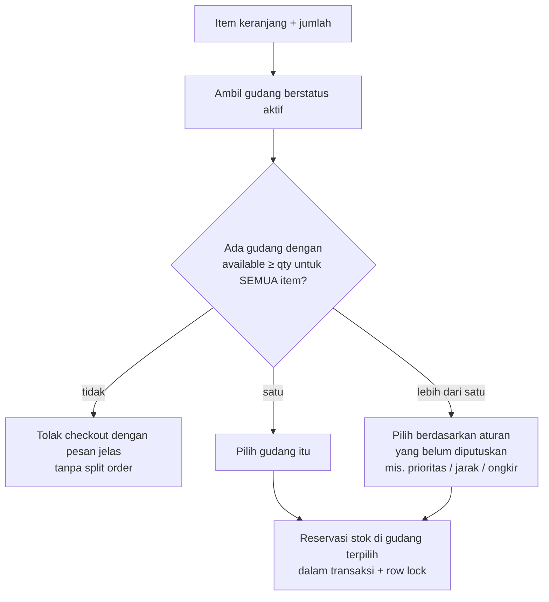
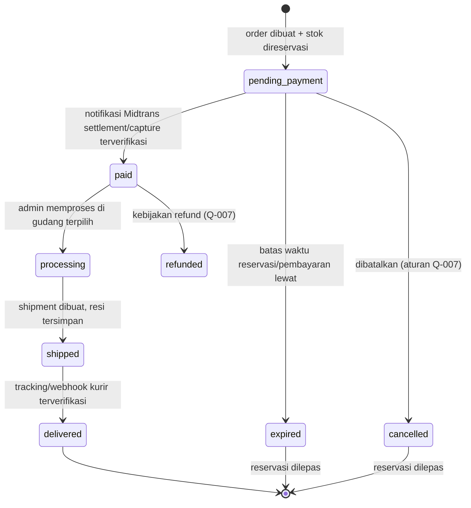
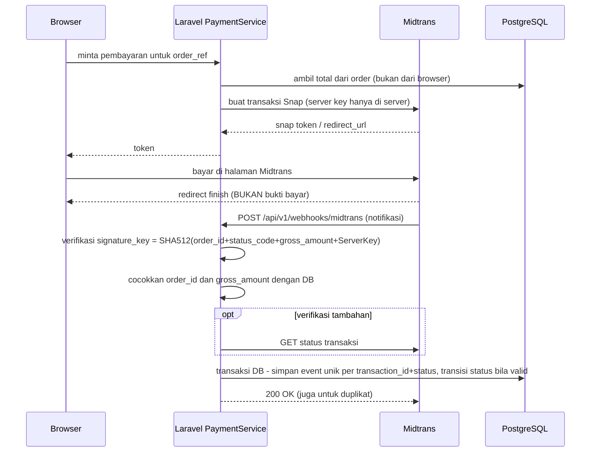
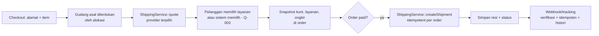

# Arsitektur Domain E-commerce — `PROPOSED`

> **Seluruh isi dokumen ini adalah usulan.** Tidak ada satu pun alur di bawah yang sudah ada di kode per 2026-10-30. Usulan diturunkan dari aturan di [../product/BUSINESS_RULES.md](../product/BUSINESS_RULES.md), PRD v0.2, MVP v0.2, dan rekomendasi arsitektur di Panduan API Pengiriman dan Panduan Payment Gateway. Usulan memerlukan persetujuan technical lead sebelum diimplementasikan. Nilai yang belum diputuskan bisnis (durasi reservasi, aturan voucher, pilihan kurir) ditandai sebagai parameter, bukan angka tetap.

## 1. Modul yang Diusulkan

| Modul | Tanggung jawab | Aturan terkait |
|---|---|---|
| Catalog | Produk, varian/SKU, foto, harga, berat/dimensi, status publikasi | BR-01, FR-01 |
| Inventory | Gudang, stok per varian per gudang, reservasi, pergerakan stok | BR-04–BR-07, BR-10 |
| Cart | Keranjang tamu berbasis sesi/token | BR-02 |
| Checkout | Hitung ulang harga/promo/ongkir/total, pilih gudang, buat order | BR-07, BR-08 |
| Order | Order, item snapshot, status, audit trail | BR-09, BR-12, BR-21 |
| Payment | Transaksi Midtrans, notifikasi, idempotensi, rekonsiliasi | BR-11, BR-12 |
| Shipping | Tarif, shipment, resi, tracking via provider yang dapat diganti; Biteship untuk MVP | BR-16, D-020 |
| Promotion | Voucher/promo dengan validasi server | BR-13–BR-15 |
| Admin | Manajemen data + RBAC + audit log | BR-17 |

## 2. Alur Browsing Produk — `PROPOSED`

## 3. Alur Keranjang dan Checkout — `PROPOSED`

Kunci integritas:

- Harga, diskon, ongkir, dan total dihitung di server (BR-08).
- Satu gudang per order; tidak ada split (BR-06, BR-07).
- Stok dikunci dalam transaksi database; constraint `CHECK (quantity >= 0)` dan `reserved <= quantity` di level database (BR-10).
- `Idempotency-Key` mencegah order ganda saat retry.
- Durasi reservasi = parameter konfigurasi, menunggu Q-006.

## 4. Alokasi Gudang — `PROPOSED`

Saat peluncuran hanya Malang aktif, jadi cabang "lebih dari satu" belum terjadi. Aturan pemilihan untuk banyak gudang belum diputuskan.

## 5. Siklus Hidup Order — `PROPOSED`

Status order, pembayaran, dan pengiriman disimpan di kolom/tabel terpisah (BR-21). Transisi hanya lewat service yang memvalidasi status asal; setiap transisi dicatat di audit trail.

## 6. Siklus Pembayaran dan Webhook Aman (Midtrans) — `PROPOSED`

Ketentuan:

- Signature tidak cocok → abaikan dan catat sebagai event mencurigakan.
- Notifikasi bisa datang tidak berurutan; status tidak boleh mundur (mis. `settlement` tidak tertimpa `pending`).
- Event duplikat tidak mengubah status atau stok dua kali.
- Formula signature berdasarkan dokumentasi resmi Midtrans ([Handle Notifications](https://docs.midtrans.com/reference/handle-notifications)); verifikasi ulang terhadap dokumentasi terbaru saat implementasi.

## 7. Alur Pengiriman — `PROPOSED`

Mengikuti Panduan API Pengiriman §8: `ShippingService` dengan antarmuka provider, sehingga penyedia (Biteship, J&T, SiCepat, Anteraja) dapat diganti tanpa menulis ulang checkout. Provider MVP: Biteship (D-020).

## 8. ERD yang Diusulkan

Lihat [../database/DATABASE.md](../database/DATABASE.md) bagian 4.
