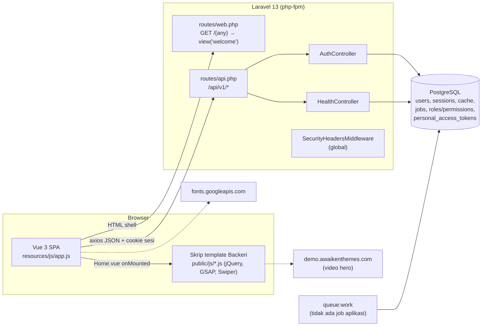
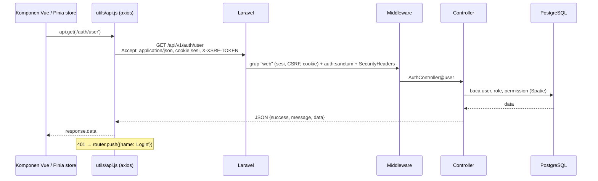
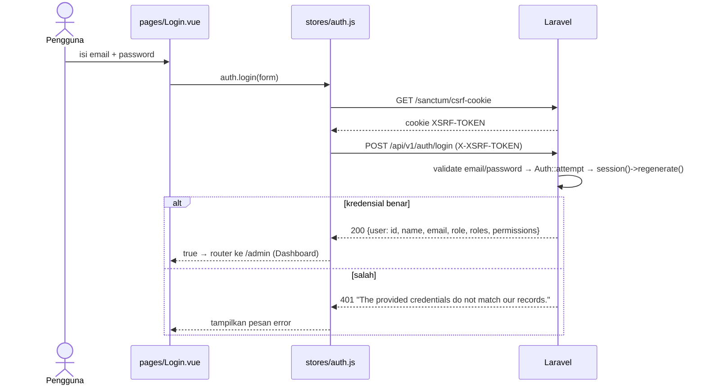
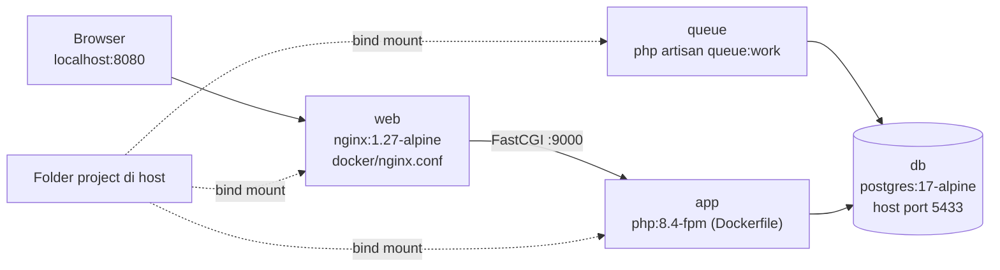

# Gambaran Sistem (Kondisi Aktual)

> Diverifikasi terhadap kode pada 2026-10-30. Semua yang ada di dokumen ini `IMPLEMENTED` kecuali diberi label lain. Arsitektur domain e-commerce yang belum dibangun ada di [PROPOSED_DOMAIN_ARCHITECTURE.md](PROPOSED_DOMAIN_ARCHITECTURE.md).

## 1. Ringkasan

Tuffero saat ini adalah **kerangka aplikasi**, belum toko online yang berfungsi. Yang sudah ada:

- Laravel 13.38 (PHP 8.5 lokal, PHP 8.4 di Docker) dengan PostgreSQL.
- Frontend Vue 3 Single Page Application (SPA) dengan `vue-router` dan Pinia, dibundel Vite 8.
- Homepage berupa port template pihak ketiga "Backeri" (Bootstrap 5.3.3 + jQuery + plugin) ke komponen Vue.
- API JSON `/api/v1` dengan tiga endpoint autentikasi (Sanctum, sesi cookie) dan satu endpoint health.
- Paket RBAC `spatie/laravel-permission` terpasang, tetapi belum ada role atau permission.
- Docker Compose untuk development lokal (app, queue, nginx, postgres).

Belum ada: katalog, keranjang, checkout, order, stok, gudang, pembayaran, pengiriman, promosi, admin fungsional, AI. Lihat [../AI_PROJECT_CONTEXT.md](../AI_PROJECT_CONTEXT.md) bagian 10.

## 2. Arsitektur Saat Ini

## 3. Siklus Request Frontend ke Backend

### 3.1 Muat halaman (semua path non-API)

1. Browser meminta path apa pun, misalnya `/`, `/login`, `/admin`.
2. `routes/web.php` menangkap semua path dengan `Route::get('/{any}', ...)->where('any', '.*')` dan mengembalikan `resources/views/welcome.blade.php`.
3. `welcome.blade.php` memuat 8 file CSS template dari `public/css`, Google Fonts (Lora, Plus Jakarta Sans), lalu `@vite(['resources/css/app.css', 'resources/js/app.js'])`, dan menyediakan `
`.
4. `resources/js/app.js` membuat aplikasi Vue, memasang Pinia dan router, mendaftarkan helper global `$can` dan `$hasRole`, lalu `mount('#app')`.
5. `resources/js/router.js` memilih komponen halaman (lazy-loaded) dan menjalankan guard `beforeEach`.

Konsekuensi: path yang tidak ada (termasuk `GET /api/v1/path-tidak-ada`) mengembalikan HTML SPA dengan status 200, bukan 404. Lihat temuan SEC-11 di [../security/SECURITY_AUDIT.md](../security/SECURITY_AUDIT.md).

### 3.2 Panggilan API

- `resources/js/utils/api.js`: axios instance, `baseURL: '/api/v1'`, `withCredentials: true`, header `Accept: application/json`. Interceptor mengarahkan ke halaman Login bila menerima 401.
- Semua respons memakai format dari `app/Traits/ApiResponse.php`: `{success, message, data}` untuk sukses dan `{success, message, errors}` untuk gagal.
- `bootstrap/app.php` membuat semua error di `api/*` berformat JSON dan menormalkan 401/403 (termasuk exception Spatie) ke format yang sama.

## 4. Alur Autentikasi (`IMPLEMENTED`, belum dipakai untuk data apa pun)

- Guard router (`resources/js/router.js`): route `meta.public` lewat langsung; route lain memanggil `fetchUser()` jika belum ada user; `requiresAuth` tanpa sesi diarahkan ke Login; `guestOnly` dengan sesi diarahkan ke Dashboard; `meta.permission` dan `meta.role` dicek terhadap data user dari server.
- Guard di frontend **hanya untuk UX**. Belum ada endpoint admin di backend yang perlu dilindungi; saat dibuat, wajib memakai middleware `permission:`/`role:` atau Policy di server.
- Tabel `users` saat ini kosong dan tidak ada seeder, jadi login belum bisa dipakai siapa pun.
- Logout: `POST /api/v1/auth/logout` → `Auth::guard('web')->logout()`, invalidasi sesi, regenerasi token CSRF.

## 5. Arsitektur Deployment

### 5.1 Development lokal (`IMPLEMENTED`)

Dua cara menjalankan:

1. Host langsung: `php artisan serve` (port 8000) + PostgreSQL lokal port 5432 + `npm run dev`/`npm run build`.
2. Docker Compose (`docker-compose.yml`), diverifikasi berjalan 2026-10-30:

- Kode di-mount dari host, sehingga `vendor/` dan `public/build` dari host yang dipakai container.
- Database container terpisah dari PostgreSQL lokal di port 5432.
- `Dockerfile` multi-stage: Node 24 untuk `npm run build`, lalu `php:8.4-fpm-bookworm` dengan ekstensi `pdo_pgsql`, `gd`, `intl`, `zip`, `bcmath`, `opcache`, `pcntl`, `redis`.

### 5.2 Produksi (`PLANNED`, belum ada)

Menurut D-002 sampai D-004: domain `tuffero.com` di Jagoan Hosting, VPS Niagahoster, dikelola Ernando. Paket VPS, OS, cara deploy, SSL, backup, dan monitoring belum ditentukan (Q-015). Tidak ada konfigurasi produksi, CI/CD, atau runbook di repository. Lihat [../infrastructure/ENVIRONMENT_AND_DEPLOYMENT.md](../infrastructure/ENVIRONMENT_AND_DEPLOYMENT.md).

## 6. Struktur Direktori yang Relevan

| Path | Isi aktual |
|---|---|
| `app/Http/Controllers/Controller.php` | Base controller dengan trait `AuthorizesRequests` |
| `app/Http/Controllers/Api/V1/` | `AuthController`, `HealthController` |
| `app/Http/Middleware/SecurityHeadersMiddleware.php` | Header keamanan global |
| `app/Traits/ApiResponse.php` | Format respons JSON standar |
| `app/Repositories/BaseRepository.php`, `app/Contracts/Repositories/RepositoryInterface.php` | Pola repository generik; **belum dipakai** oleh kelas mana pun |
| `app/Models/User.php` | Satu-satunya model; trait `HasApiTokens`, `HasRoles` |
| `bootstrap/app.php` | Routing web/api, middleware global, alias Spatie, format error API |
| `routes/web.php`, `routes/api.php` | Catch-all SPA; API v1 |
| `resources/views/welcome.blade.php` | Shell SPA |
| `resources/views/layouts`, `partials`, `legacy/` | Blade lama; **tidak dipakai route mana pun** |
| `resources/js/` | SPA Vue (lihat [FRONTEND_ARCHITECTURE.md](FRONTEND_ARCHITECTURE.md)) |
| `public/css`, `public/js`, `public/images`, `public/webfonts` | Aset template Backeri |
| `theme/` | Mirror HTTrack template Backeri; bukan bagian aplikasi |
| `TUFFERO/` | Dokumen bisnis/desain (lihat [../product/REFERENCE_DOCUMENTS.md](../product/REFERENCE_DOCUMENTS.md)) |
| `Dockerfile`, `docker-compose.yml`, `docker/nginx.conf`, `.dockerignore` | Container development |
| `phpstan.neon`, `pint.json` | Larastan level 5 untuk `app/`; Pint preset `laravel` |
