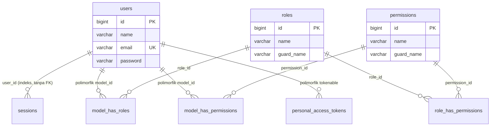
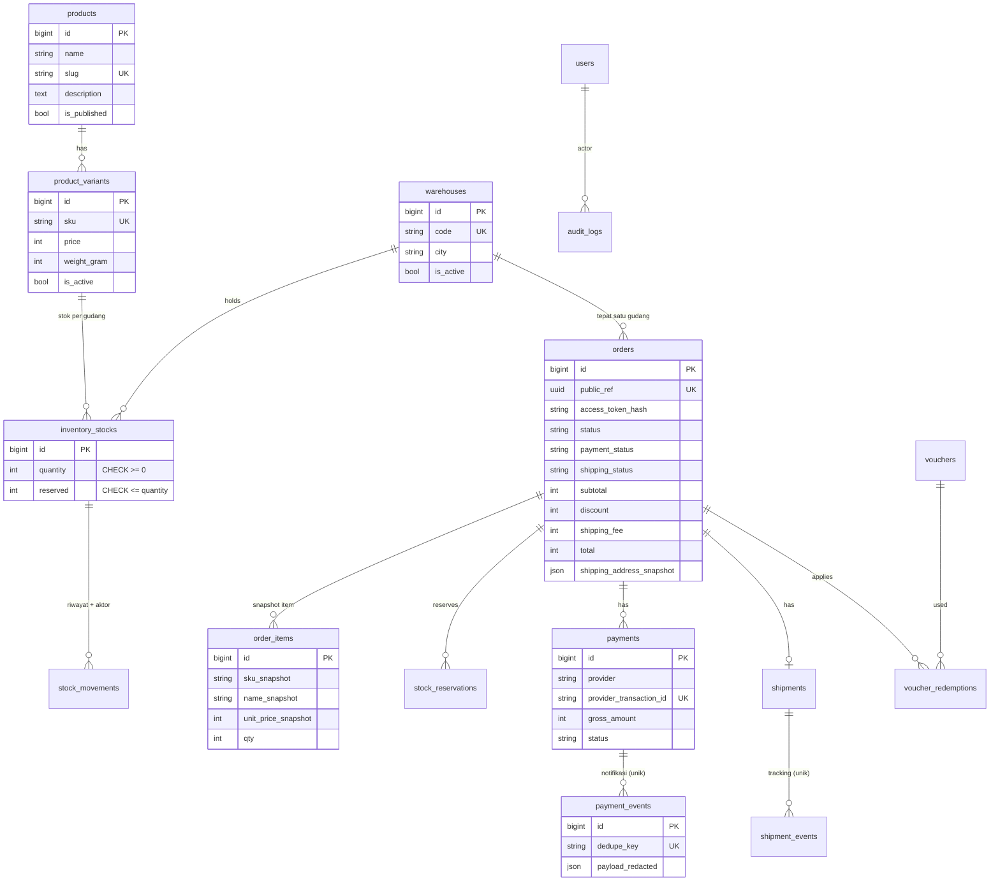

# Database

> Skema saat ini diverifikasi dengan `php artisan db:show`, `db:table users`, dan `migrate:status` terhadap PostgreSQL lokal pada 2026-10-30 (operasi baca saja). Tidak ada kredensial yang dicatat.

## 1. Konfigurasi

| Item | Nilai |
|---|---|
| Driver | `pgsql` (PostgreSQL 18.3 lokal; `postgres:17-alpine` di Docker) |
| Database | `tuffero` |
| Koneksi lokal | `127.0.0.1:5432` |
| Koneksi Docker | service `db`, port host `5433` |
| Test | SQLite `:memory:` (`phpunit.xml`), tidak menyentuh PostgreSQL |
| `.env.example` | `DB_CONNECTION=pgsql`, host/port/database/username contoh, password kosong |

Credential nyata ada di `.env` (diabaikan Git) dan tidak dibaca saat audit.

## 2. Tabel yang Ada Saat Ini

Semua tabel berasal dari migration bawaan Laravel atau paket. **Tidak ada tabel domain e-commerce.**

| Migration | Batch | Tabel | Asal |
|---|---|---|---|
| `0001_01_01_000000_create_users_table` | 1 | `users`, `password_reset_tokens`, `sessions` | Laravel |
| `0001_01_01_000001_create_cache_table` | 1 | `cache`, `cache_locks` | Laravel |
| `0001_01_01_000002_create_jobs_table` | 1 | `jobs`, `job_batches`, `failed_jobs` | Laravel |
| `2026_10_30_063747_create_permission_tables` | 2 | `permissions`, `roles`, `model_has_permissions`, `model_has_roles`, `role_has_permissions` | spatie/laravel-permission |
| `2026_10_30_063747_create_personal_access_tokens_table` | 2 | `personal_access_tokens` | laravel/sanctum |

Isi data (hitungan baris, 2026-10-30): `users` 0, `roles` 0, `permissions` 0. Tidak ada seeder untuk role atau user admin.

### `users` (terverifikasi)

| Kolom | Tipe | Null | Catatan |
|---|---|---|---|
| `id` | bigint, auto increment | tidak | PK `users_pkey` |
| `name` | varchar(255) | tidak | |
| `email` | varchar(255) | tidak | unique `users_email_unique` |
| `email_verified_at` | timestamp(0) | ya | belum dipakai |
| `password` | varchar(255) | tidak | cast `hashed` di model (bcrypt, `BCRYPT_ROUNDS=12`) |
| `remember_token` | varchar(100) | ya | |
| `created_at`, `updated_at` | timestamp(0) | ya | |

Model `App\Models\User`: `#[Fillable(['name','email','password'])]`, `#[Hidden(['password','remember_token'])]`, trait `HasApiTokens`, `HasFactory`, `HasRoles`, `Notifiable`.

## 3. ERD Saat Ini (`IMPLEMENTED`)

Hanya relasi yang dibuat migration bawaan/paket. `model_has_roles` dan `model_has_permissions` bersifat polimorfik (`model_type`, `model_id`), jadi relasinya ke `users` tidak berupa foreign key database.

Tabel `cache`, `cache_locks`, `jobs`, `job_batches`, `failed_jobs`, `password_reset_tokens` berdiri sendiri.

## 4. ERD yang Diusulkan — `PROPOSED`

Belum ada di kode. Diturunkan dari PRD FR-01 sampai FR-06 dan aturan BR-04 sampai BR-21. Nama kolom indikatif; finalisasi saat desain migration.

Prinsip yang diusulkan:

- Uang disimpan sebagai integer rupiah (tanpa float).
- `orders.public_ref` (UUID) untuk referensi publik; ID numerik tidak diekspos sebagai satu-satunya kunci akses.
- Constraint database untuk stok tidak minus, bukan hanya validasi aplikasi.
- Kunci unik untuk event pembayaran/pengiriman agar notifikasi duplikat aman.
- Snapshot order tidak berubah ketika produk/harga berubah.

## 5. Strategi Migration

- Semua perubahan skema lewat migration Laravel; jangan ubah skema manual.
- Migration yang sudah berjalan di lingkungan bersama tidak diedit; buat migration baru.
- Seeder terpisah untuk data referensi (role, permission, gudang Malang) dan data contoh (hanya non-produksi).
- Uji migration di SQLite (test) **dan** PostgreSQL, karena constraint `CHECK` dan locking berbeda perilaku. Test konkurensi stok perlu PostgreSQL.
- Backup sebelum migration di produksi (belum ada prosedur; lihat [../infrastructure/ENVIRONMENT_AND_DEPLOYMENT.md](../infrastructure/ENVIRONMENT_AND_DEPLOYMENT.md)).
