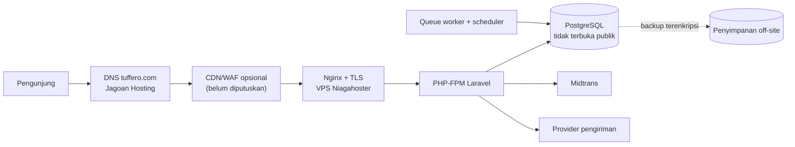

# Environment, Deployment, Backup, Monitoring

> Kondisi per 2026-10-30. Hanya development lokal yang ada. Produksi `PLANNED` (D-002, D-003, D-004), detail belum ditentukan (Q-015).

## 1. Prasyarat Lokal

| Alat | Versi terverifikasi |
|---|---|
| PHP | 8.5.6 (host); `composer.json` mensyaratkan `^8.3`; lockfile kompatibel PHP ≥ 8.4.1 |
| Composer | 2.9.7 |
| Node / npm | v26 / 11.x (host); Node 24 di Docker |
| PostgreSQL | 18.3 lokal; 17 di Docker |
| Docker | 29.8.2 |

Catatan Windows: ekstensi PHP `pdo_pgsql` harus aktif. Nama folder JS harus huruf kecil (`resources/js/pages`), karena Linux di container membedakan huruf besar-kecil.

## 2. Menjalankan di Host

```bash
composer install
cp .env.example .env        # isi credential DB sendiri; jangan commit .env
php artisan key:generate
php artisan migrate
npm install
npm run build               # atau: npm run dev
php artisan serve           # http://localhost:8000
```

## 3. Menjalankan dengan Docker (development)

```bash
composer install && npm run build     # di host: compose me-mount folder project
docker compose up -d --build
docker compose exec app php artisan migrate
# http://localhost:8080 ; Postgres container di localhost:5433
```

| Service | Image | Peran |
|---|---|---|
| `app` | build `Dockerfile` (php:8.4-fpm) | PHP-FPM :9000 |
| `queue` | build `Dockerfile` | `php artisan queue:work --tries=1`, `restart: unless-stopped` |
| `web` | `nginx:1.27-alpine` | Port 8080, config `docker/nginx.conf` |
| `db` | `postgres:17-alpine` | Volume `pgdata`, healthcheck `pg_isready` |

Variabel DB container diambil dari `.env` (`DB_DATABASE`, `DB_USERNAME`, `DB_PASSWORD`); `DB_HOST`/`DB_PORT` di-override ke `db:5432`. Compose ini **khusus development**: ada fallback password dan port DB terbuka (SEC-08).

`Dockerfile` sendiri layak menjadi dasar image produksi (multi-stage, `composer install --no-dev`, autoload teroptimasi), tetapi belum diuji untuk produksi dan belum memiliki konfigurasi opcache/php.ini produksi.

## 4. Produksi — `PLANNED`

| Aspek | Keputusan | Status |
|---|---|---|
| Domain | `tuffero.com` di Jagoan Hosting (D-002) | Disepakati |
| Server | VPS Niagahoster (D-003) | Paket, OS, resource belum ditentukan |
| Pengelola | Ernando: VPS, domain, SSL, backup, deployment, version control (D-004) | Disepakati |
| Metode deploy (Docker atau native) | — | Belum ditentukan |
| CI/CD | — | Tidak ada |
| SSL | — | Belum |
| Backup + uji restore | Wajib (PRD §6, MVP §6) | Belum ada |
| Monitoring dan alert | — | Belum ada |
| Runbook dan rollback | Wajib (MVP §2) | Belum ada |

### Arsitektur Produksi — `PROPOSED`



Checklist minimum sebelum go-live (dari [../security/SECURITY_REQUIREMENTS.md](../security/SECURITY_REQUIREMENTS.md) §I): `APP_ENV=production`, `APP_DEBUG=false`, `APP_KEY` baru, TLS + HSTS, `SESSION_SECURE_COOKIE=true`, DB user non-superuser dan privat, firewall 80/443 saja, SSH berbasis kunci, `php artisan config:cache route:cache view:cache`, worker queue dan scheduler dikelola supervisor/systemd, backup terjadwal dan uji restore, monitoring error dan uptime.

## 5. Troubleshooting yang Sudah Ditemui

| Gejala | Penyebab | Penyelesaian |
|---|---|---|
| `npm run build` di Docker gagal: `Could not resolve './pages/Home.vue'` | Folder di Windows bernama `Pages` | Rename ke `pages` (dua langkah, karena Windows tidak membedakan huruf) |
| Container `queue` mati: `relation "cache" does not exist` | Worker start sebelum migrasi | Jalankan migrate; `restart: unless-stopped` sudah ditambahkan |
| `composer require "paket:^4.0"` dari PowerShell gagal | Tanda `^` hilang di `composer.bat` | Pakai `~4.0` atau jalankan dari shell lain |
| Build Vue: `Element is missing end tag` di `Home.vue` | Tag `<a>`/`<li>` tidak tertutup di HTML template | Perbaiki HTML |
| Build Vue: `Module not found '/images/...'` | Vue mengubah `src` absolut menjadi import | `transformAssetUrls: { base: null, includeAbsolute: false }` |
