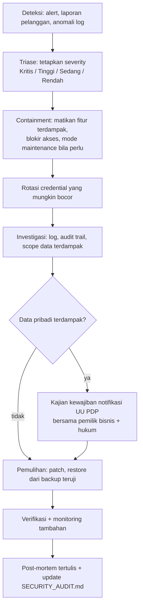

# Persyaratan Keamanan Tuffero

> Dokumen ini mendefinisikan **ekspektasi keamanan** yang harus dipenuhi kode Tuffero. Status tiap persyaratan terhadap kode saat ini ada di kolom "Status 2026-10-30". Temuan dan prioritas perbaikan ada di [SECURITY_AUDIT.md](SECURITY_AUDIT.md). Aset, aktor, dan ancaman ada di [THREAT_MODEL.md](THREAT_MODEL.md).
>
> Persyaratan ini adalah rekomendasi teknis tim pengembang dan **belum disetujui pemilik bisnis** sebagai kebijakan resmi. Persyaratan yang menyentuh aturan bisnis (mis. batas anti-fraud, retensi data) memerlukan keputusan bisnis dan ditandai demikian.

Label status: `ADA` (kontrol sudah ada di kode), `SEBAGIAN`, `BELUM` (belum ada), `N/A` (fitur terkait belum ada, persyaratan berlaku saat fitur dibuat).

## 0. Acuan dan Batasan

| Acuan | Versi yang diverifikasi 2026-10-30 | Dipakai untuk |
|---|---|---|
| [OWASP Top 10](https://owasp.org/Top10/2025/) | 2025 (rilis November 2025) | Kategori risiko aplikasi web |
| [OWASP ASVS](https://owasp.org/www-project-ASVS/) | 5.0.0 (2025) | Daftar persyaratan verifikasi |
| OWASP API Security Top 10 | 2023 (versi terbaru yang diketahui; konfirmasi ulang) | Risiko API |
| OWASP Cheat Sheet Series | Berjalan | Panduan implementasi |
| Dokumentasi keamanan Laravel | Laravel 13 | Kontrol framework |
| PCI DSS | v4.0.1 | Prinsip penanganan data kartu; target lingkup minimal lewat halaman pembayaran hosted Midtrans |
| UU No. 27/2022 tentang Pelindungan Data Pribadi (UU PDP) | Berlaku; PP pelaksana dilaporkan terbit sebagai PP 33/2026 (sumber sekunder, efektif dilaporkan 16 Januari 2027) | Kewajiban data pribadi. **Wajib dikonfirmasi oleh penasihat hukum** |
| UU ITE dan PP 71/2019 (PSTE) | Berlaku | Penyelenggaraan sistem elektronik. **Wajib dikonfirmasi oleh penasihat hukum** |

Acuan ini adalah panduan penilaian, **bukan bukti kepatuhan**. Tuffero tidak diklaim patuh OWASP, PCI DSS, UU PDP, atau regulasi lain sampai ada penilaian yang sesuai. Audit dokumentasi bukan pengganti uji penetrasi profesional.

## A. Autentikasi dan Akun

| ID | Persyaratan | Status 2026-10-30 | Bukti |
|---|---|---|---|
| AUTH-01 | Password di-hash dengan mekanisme bawaan Laravel (bcrypt/argon2) | `ADA` | `User::casts()` `'password' => 'hashed'`; `BCRYPT_ROUNDS=12` |
| AUTH-02 | Kebijakan kekuatan password (`Password::defaults()`: panjang minimal, cek kebocoran `uncompromised()` untuk admin) | `BELUM` | Tidak ada registrasi/ubah password |
| AUTH-03 | Rate limit login per kombinasi email+IP dan per IP | `BELUM` | `routes/api.php` tanpa `throttle` |
| AUTH-04 | Perlindungan credential stuffing: rate limit + pesan error generik + pemantauan lonjakan kegagalan | `SEBAGIAN` | Pesan generik ada; rate limit dan pemantauan belum |
| AUTH-05 | Reset password aman: token sekali pakai, kedaluwarsa, tidak membocorkan keberadaan akun | `N/A` | Belum ada fitur; tabel `password_reset_tokens` ada |
| AUTH-06 | Verifikasi email untuk akun admin | `BELUM` | |
| AUTH-07 | Regenerasi sesi setelah login (cegah session fixation) | `ADA` | `AuthController@login` `session()->regenerate()` |
| AUTH-08 | Logout menginvalidasi sesi dan token CSRF | `ADA` | `AuthController@logout` |
| AUTH-09 | Masa sesi dan idle timeout ditetapkan; admin lebih pendek | `SEBAGIAN` | `SESSION_LIFETIME=120` menit, sama untuk semua |
| AUTH-10 | Cookie sesi: `Secure` di produksi, `HttpOnly`, `SameSite=Lax` atau lebih ketat | `SEBAGIAN` | `http_only` default true, `same_site` lax; `secure` bergantung `SESSION_SECURE_COOKIE` yang tidak diset |
| AUTH-11 | MFA wajib untuk akun admin/staf | `BELUM` | |
| AUTH-12 | MFA opsional untuk pelanggan (jika akun pelanggan dibuat) | `N/A` | Login pelanggan di luar MVP |
| AUTH-13 | Catat login berhasil/gagal, logout, perubahan password; deteksi pola mencurigakan | `BELUM` | Tidak ada logging di `AuthController` |
| AUTH-14 | Akses status pesanan guest tanpa akun memakai referensi acak (UUID) + token rahasia acak yang di-hash di DB, atau tautan bertanda tangan yang dikirim ke email/HP pembeli. ID order berurutan **tidak boleh** menjadi satu-satunya kunci | `N/A` | Keputusan mekanisme: Q-008 |

## B. Otorisasi dan Keamanan Admin

| ID | Persyaratan | Status | Bukti |
|---|---|---|---|
| AUTHZ-01 | RBAC dengan role dan permission eksplisit; daftar role diputuskan bisnis (Q-009) | `SEBAGIAN` | Spatie terpasang + alias middleware; tabel `roles`/`permissions` kosong |
| AUTHZ-02 | Setiap endpoint admin dilindungi di server (`permission:`/`role:` middleware atau Policy). Guard Vue hanya UX | `N/A` | Belum ada endpoint admin. Route `/admin` di SPA hanya mengecek sesi |
| AUTHZ-03 | Pemisahan pelanggan, staf, admin; pelanggan tidak pernah bisa mengakses API admin | `BELUM` | Semua user terautentikasi diperlakukan sama |
| AUTHZ-04 | Least privilege: role default tanpa permission; Super Admin minimal jumlahnya | `BELUM` | |
| AUTHZ-05 | Cegah eskalasi hak: perubahan role/permission hanya oleh role tertinggi dan tercatat | `BELUM` | |
| AUTHZ-06 | Cegah IDOR: setiap akses resource dicek kepemilikan/izin (Policy), bukan sekadar ID dari URL | `N/A` | |
| AUTHZ-07 | Aksi berisiko tinggi (ubah harga, penyesuaian stok, refund, kelola user/role) butuh permission khusus dan audit trail; pertimbangkan persetujuan ganda untuk refund | `N/A` | Aturan persetujuan = keputusan bisnis |
| AUTHZ-08 | Audit trail aksi admin: aktor, waktu, aksi, objek, nilai sebelum/sesudah, IP | `BELUM` | |

## C. Keamanan Aplikasi Web

| ID | Persyaratan | Status | Bukti |
|---|---|---|---|
| WEB-01 | Validasi server-side semua input (Form Request) | `SEBAGIAN` | Hanya `login` yang memvalidasi; belum ada endpoint lain |
| WEB-02 | Output encoding: Vue `{{ }}` dan Blade `{{ }}`; larang `v-html`/`{!! !!}` untuk data pengguna kecuali disanitasi | `ADA` | Tidak ditemukan `v-html`, `innerHTML`, `{!! !!}` di kode aktif |
| WEB-03 | CSRF aktif untuk semua request yang mengubah state dengan sesi cookie | `ADA` | Route auth memakai grup `web`; terverifikasi 419 tanpa token |
| WEB-04 | Query lewat Eloquent/Query Builder dengan binding; larang `DB::raw` dengan input pengguna | `ADA` | Tidak ada raw query |
| WEB-05 | Mass assignment dibatasi (`#[Fillable]`/`$fillable`, `$request->validated()`) | `ADA` | `User` memakai `#[Fillable]` |
| WEB-06 | Upload file: validasi MIME dan ekstensi, batas ukuran, nama acak, simpan di luar webroot atau disk privat, tidak dieksekusi | `N/A` | Nginx `client_max_body_size 20M`; belum ada upload |
| WEB-07 | Cegah SSRF: URL keluar hanya ke host provider yang di-whitelist; jangan fetch URL dari input pengguna | `N/A` | |
| WEB-08 | Cegah open redirect: redirect hanya ke path internal atau allowlist | `N/A` | |
| WEB-09 | Tidak ada unserialize data tak tepercaya | `ADA` | Tidak ditemukan |
| WEB-10 | Content Security Policy ketat tanpa `unsafe-eval` dan tanpa wildcard `https:`/`http:` untuk script | `BELUM` | CSP saat ini mengizinkan semua sumber (SEC-02) |
| WEB-11 | Header: HSTS, `X-Content-Type-Options`, `X-Frame-Options`/`frame-ancestors`, `Referrer-Policy`, `Permissions-Policy` | `SEBAGIAN` | Tiga header ada; HSTS dan Permissions-Policy belum |
| WEB-12 | HTTPS wajib di produksi; redirect HTTP→HTTPS; `TrustProxies` dikonfigurasi bila di belakang proxy | `BELUM` | Belum ada konfigurasi produksi |
| WEB-13 | `APP_DEBUG=false` dan `APP_ENV=production` di produksi; error tidak menampilkan stack trace | `BELUM` | `.env.example` `APP_DEBUG=true`; belum ada env produksi |
| WEB-14 | Endpoint publik tidak membocorkan pesan exception, versi, atau konfigurasi | `BELUM` | `/api/v1/health` (SEC-04); header `Server`/`X-Powered-By` di Docker (SEC-10) |
| WEB-15 | CORS: hanya origin `tuffero.com` (dan subdomain yang perlu) bila API diakses lintas origin | `SEBAGIAN` | `config/cors.php` belum dipublikasikan; default framework |

## D. Integritas Transaksi E-commerce

Semua `N/A` karena modul belum ada; wajib dipenuhi saat dibangun. Alur usulan: [../architecture/PROPOSED_DOMAIN_ARCHITECTURE.md](../architecture/PROPOSED_DOMAIN_ARCHITECTURE.md).

| ID | Persyaratan |
|---|---|
| TRX-01 | Harga, diskon, ongkir, total selalu dibaca/dihitung di server. Field harga/total dari request diabaikan (BR-08) |
| TRX-02 | Produk nonaktif/tidak dipublikasikan dan varian nonaktif tidak bisa dibeli; batas jumlah per item divalidasi |
| TRX-03 | Isi keranjang divalidasi ulang dan stok dicek ulang saat checkout |
| TRX-04 | Pembuatan order, reservasi, dan pengurangan stok dalam satu transaksi database dengan row lock (`lockForUpdate`) atau update atomik bersyarat |
| TRX-05 | Constraint database mencegah stok minus dan reservasi melebihi stok |
| TRX-06 | Reservasi punya waktu kedaluwarsa dan dilepas oleh job terjadwal; durasi = keputusan bisnis (Q-006) |
| TRX-07 | Idempotency key untuk checkout dan pembuatan pembayaran; submit ganda tidak membuat order ganda |
| TRX-08 | Voucher divalidasi di server: aktif, periode, kuota global, batas per pelanggan, minimum transaksi, cakupan SKU; penggunaan dicatat secara atomik (aturan = Q-005) |
| TRX-09 | Transisi status order hanya lewat state machine yang memvalidasi status asal; tidak bisa diubah dari request pelanggan |
| TRX-10 | Pelanggan/guest hanya bisa melihat ordernya sendiri (AUTH-14); admin sesuai permission |
| TRX-11 | Satu order tepat satu gudang; validasi di server (BR-06, BR-07) |
| TRX-12 | Setiap pergerakan stok tercatat (jenis, jumlah, gudang, order/aktor, waktu); penyesuaian manual butuh permission dan alasan |
| TRX-13 | Rate limit pada checkout, validasi voucher, lookup order guest, dan pembuatan pembayaran |
| TRX-14 | Sinyal anti-fraud dicatat untuk review manual (mis. kegagalan bayar berulang, banyak order dari IP/HP yang sama, percobaan voucher berulang). **Ambang dan tindakan otomatis memerlukan persetujuan bisnis**; jangan memblokir pelanggan otomatis tanpa persetujuan |

## E. Pembayaran (Midtrans)

| ID | Persyaratan |
|---|---|
| PAY-01 | Tidak menyimpan nomor kartu, CVV, atau data autentikasi kartu. Pakai halaman/token hosted Midtrans agar data kartu tidak melewati server Tuffero |
| PAY-02 | Server key hanya di environment server; tidak pernah dikirim ke browser, log, atau repository. Client key boleh di frontend |
| PAY-03 | Credential sandbox dan produksi terpisah; produksi hanya di server produksi |
| PAY-04 | Verifikasi `signature_key` setiap notifikasi: SHA-512 dari `order_id + status_code + gross_amount + ServerKey`; bandingkan dengan `hash_equals` |
| PAY-05 | Cocokkan `order_id`, `gross_amount`, dan mata uang dengan order di database; tolak jika berbeda |
| PAY-06 | Redirect "finish" browser tidak mengubah status menjadi paid |
| PAY-07 | Notifikasi diproses idempoten (kunci unik per transaksi + status); replay tidak mengubah apa pun dua kali |
| PAY-08 | Status tidak boleh mundur karena notifikasi tidak berurutan |
| PAY-09 | Tangani pending, settlement/capture, deny, cancel, expire, refund; stok dilepas saat gagal/kedaluwarsa/batal |
| PAY-10 | Event pembayaran dicatat untuk audit dengan payload tersaring (tanpa data sensitif) |
| PAY-11 | Endpoint webhook dikecualikan dari CSRF secara spesifik (hanya path itu), diberi rate limit, dan hanya menerima `POST` |
| PAY-12 | Rekonsiliasi berkala dengan laporan Midtrans |

Status semua: `N/A` (belum ada integrasi). Detail alur: [../architecture/PROPOSED_DOMAIN_ARCHITECTURE.md](../architecture/PROPOSED_DOMAIN_ARCHITECTURE.md) §6.

## F. Pengiriman (Biteship atau API kurir langsung)

| ID | Persyaratan |
|---|---|
| SHP-01 | API key provider hanya di environment server |
| SHP-02 | Webhook diverifikasi dengan mekanisme resmi provider. Untuk Biteship mekanismenya **`NOT VERIFIED`**; jika provider tidak menyediakan tanda tangan, gunakan secret di URL/header yang disepakati + validasi status via API provider |
| SHP-03 | Update status pengiriman divalidasi (urutan status, resi cocok dengan order) dan idempoten |
| SHP-04 | Ongkir diambil ulang di server saat checkout; nilai dari browser diabaikan |
| SHP-05 | Pembuatan shipment idempoten per order; retry tidak membuat resi ganda |
| SHP-06 | Alamat dan nomor HP pelanggan hanya dikirim ke provider yang diperlukan dan tidak ditulis ke log |
| SHP-07 | Data tracking hanya dapat dilihat pemilik order (AUTH-14) dan admin berwenang |

## G. API

| ID | Persyaratan | Status |
|---|---|---|
| API-01 | Endpoint terlindungi memakai `auth:sanctum` + otorisasi | `SEBAGIAN` (endpoint auth saja) |
| API-02 | Rate limit untuk semua endpoint publik dan auth | `BELUM` |
| API-03 | Validasi input dan batas ukuran request | `SEBAGIAN` |
| API-04 | Error API tidak membocorkan exception, query, atau konfigurasi | `SEBAGIAN` (format JSON ada; debug mode dan health endpoint membocorkan) |
| API-05 | Token API (jika dipakai): masa berlaku, revokasi, scope minimal | `N/A` (SPA memakai sesi; `sanctum.expiration` null) |
| API-06 | Versi API di path (`/api/v1`) | `ADA` |
| API-07 | Path API yang tidak ada mengembalikan 404 JSON | `BELUM` (SEC-11) |
| API-08 | Resource API (`JsonResource`) hanya mengekspos field yang diperlukan | `N/A` |

## H. Database dan Pelindungan Data

| ID | Persyaratan |
|---|---|
| DATA-01 | Akun database aplikasi dengan hak minimum (bukan superuser `postgres`) di produksi |
| DATA-02 | Database tidak terbuka ke internet; hanya diakses dari aplikasi/jaringan privat |
| DATA-03 | Minimisasi data: hanya kumpulkan data yang dibutuhkan checkout dan pengiriman |
| DATA-04 | Retensi dan penghapusan data pribadi mengikuti kebijakan yang **belum diputuskan** (Q-014). Jangan mengarang masa simpan |
| DATA-05 | Backup terenkripsi, disimpan terpisah dari server, diuji restore secara berkala |
| DATA-06 | Log dan ekspor tidak memuat password, secret, data kartu, atau data pribadi yang tidak perlu |
| DATA-07 | Audit trail untuk perubahan data sensitif |
| DATA-08 | Hak subjek data (akses, koreksi, hapus) dan pemberitahuan kebocoran sesuai UU PDP: **perlu kajian hukum** |

Inventaris data pribadi: [THREAT_MODEL.md](THREAT_MODEL.md) §2.

## I. Infrastruktur dan Deployment

| ID | Persyaratan |
|---|---|
| INF-01 | TLS di produksi (sertifikat valid, TLS 1.2+), HSTS |
| INF-02 | Secret di environment server/secret manager; `.env` tidak pernah di-commit (sudah di `.gitignore`) |
| INF-03 | Patch OS dan paket terjadwal |
| INF-04 | Firewall: hanya 80/443 publik; SSH dibatasi (kunci, tanpa login root/password, IP terbatas) |
| INF-05 | Database dan Redis tidak terbuka publik |
| INF-06 | Permission file: `storage/`, `bootstrap/cache` writable oleh user web saja; kode read-only |
| INF-07 | Web server: root ke `public/`, blokir dotfile, sembunyikan versi (`server_tokens off`, `expose_php=Off`) |
| INF-08 | `theme/`, `docs/`, `TUFFERO/`, `tests/`, tool dev tidak ikut image/deploy produksi (sebagian sudah di `.dockerignore`) |
| INF-09 | Monitoring dependensi (`composer audit`, `npm audit`) di CI |
| INF-10 | Evaluasi CDN/WAF/proteksi bot dan DDoS (mis. layanan CDN dengan WAF) sebelum peluncuran; belum dikonfigurasi dan belum diputuskan |

Status semua: `BELUM` atau `N/A`, karena belum ada lingkungan produksi (Q-015). Docker Compose saat ini khusus development.

## J. Logging, Monitoring, dan Respons Insiden

| ID | Persyaratan |
|---|---|
| LOG-01 | Log event: autentikasi (berhasil/gagal), aksi admin, event pembayaran, perubahan status order, penyesuaian stok |
| LOG-02 | Deteksi aktivitas mencurigakan: lonjakan login gagal, signature webhook tidak valid, kegagalan bayar berulang |
| LOG-03 | Monitoring error (mis. layanan error tracking) dan alert ke PIC |
| LOG-04 | Klasifikasi severity insiden dan prosedur respons tertulis |
| LOG-05 | Prosedur rotasi credential (APP_KEY, DB, Midtrans, kurir) |
| LOG-06 | Prosedur restore backup yang sudah diuji |
| LOG-07 | Dokumentasi setiap insiden keamanan |

Status semua: `BELUM`.

### Alur Respons Insiden — `PROPOSED`

PIC insiden belum ditetapkan; D-004 menetapkan Ernando untuk infrastruktur.

## K. Dependensi dan Supply Chain

| ID | Persyaratan | Status |
|---|---|---|
| DEP-01 | Lockfile (`composer.lock`, `package-lock.json`) di-commit | `SEBAGIAN`: `composer.lock` ter-track; `package-lock.json` belum di-commit |
| DEP-02 | `composer audit` dan `npm audit` rutin dan di CI | `BELUM` (dijalankan manual saat audit) |
| DEP-03 | Paket yang tidak dipakai dihapus | `BELUM` (`quill`, `@fortawesome/fontawesome-free` tidak dipakai) |
| DEP-04 | Skrip pihak ketiga di frontend diinventaris, asal dan lisensinya jelas, dan diperbarui; halaman checkout memuat skrip seminimal mungkin | `BELUM` (17 skrip template + hotlink video) |
| DEP-05 | Update dependensi terjadwal dengan test | `BELUM` |

## L. Pengujian Keamanan

Strategi dan daftar test: [../quality/TESTING_STRATEGY.md](../quality/TESTING_STRATEGY.md) §3.
