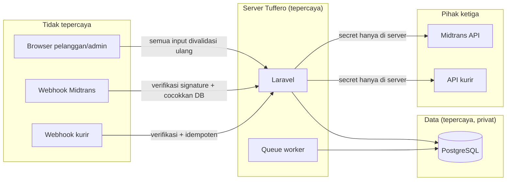

# Threat Model Tuffero

> Model ancaman untuk sistem **yang direncanakan** (PRD v0.2), karena sistem saat ini belum memproses data pelanggan atau transaksi. Diperbarui setiap kali modul baru dibangun. Kategori mengikuti OWASP Top 10:2025 dan OWASP API Security Top 10.

## 1. Aset

| Aset | Mengapa penting | Ada di sistem sekarang? |
|---|---|---|
| Akun admin/staf | Mengendalikan harga, stok, order, refund | Tabel `users` ada, kosong |
| Data pribadi pelanggan | Kewajiban UU PDP, kepercayaan pelanggan | Belum |
| Order dan snapshot harga | Bukti transaksi, dasar fulfillment | Belum |
| Status pembayaran | Menentukan barang dikirim atau tidak | Belum |
| Stok per gudang | Overselling = kerugian dan komplain | Belum |
| Voucher/promo | Penyalahgunaan = kerugian langsung | Belum |
| Credential Midtrans dan kurir | Penyalahgunaan transaksi/pengiriman | Belum |
| `APP_KEY`, credential DB | Kompromi sesi, cookie terenkripsi, URL bertanda tangan, database | Ada di `.env` |
| Kode dan pipeline deploy | Supply chain | Repository GitHub privat |

## 2. Inventaris Data Pribadi (Rencana)

| Data | Sumber | Tujuan | Status |
|---|---|---|---|
| Nama penerima | Checkout | Pengiriman | `PLANNED` |
| Email | Checkout | Konfirmasi order, akses status order | `PLANNED` |
| Nomor HP | Checkout | Kurir, kontak | `PLANNED` |
| Alamat lengkap | Checkout | Pengiriman | `PLANNED` |
| Riwayat order | Transaksi | Layanan, akuntansi | `PLANNED` |
| Referensi pembayaran (bukan data kartu) | Midtrans | Rekonsiliasi | `PLANNED` |
| Nama, email, hash password admin | Admin | Akses sistem | `IMPLEMENTED` (struktur tabel `users`) |
| Percakapan AI CS | Pelanggan | Layanan | `PLANNED` (P1) |
| IP address, user agent | Request | Keamanan, rate limit | Sesi menyimpan IP dan user agent di tabel `sessions` |

Data kartu pembayaran **tidak boleh** disimpan atau melewati server Tuffero (PAY-01). Masa retensi dan dasar pemrosesan: **belum diputuskan** (Q-014).

## 3. Aktor Ancaman

| Aktor | Motif | Contoh |
|---|---|---|
| Pembeli curang | Barang murah/gratis | Manipulasi harga/total, penyalahgunaan voucher, klaim bayar palsu |
| Bot/scalper | Borong stok, uji kartu curian | Checkout otomatis massal |
| Penyerang oportunis | Akses admin, data pelanggan | Credential stuffing, eksploitasi dependensi |
| Pihak ketiga yang dikompromikan | Supply chain | Skrip CDN/template yang disusupi |
| Orang dalam | Penyalahgunaan hak | Ubah harga/stok/refund tanpa jejak |
| Pengirim webhook palsu | Status bayar/kirim palsu | POST notifikasi palsu ke endpoint webhook |

## 4. Ancaman Utama dan Kontrol

| Ancaman | Kategori | Kontrol (persyaratan) |
|---|---|---|
| Akses admin oleh pihak tidak berwenang | A01 Broken Access Control, A07 Authentication Failures | AUTH-03, AUTH-11, AUTHZ-01–08 |
| IDOR pada order guest | A01, API1 BOLA | AUTH-14, AUTHZ-06, TRX-10 |
| Manipulasi harga/total/ongkir dari browser | A06 Insecure Design | TRX-01, SHP-04 |
| Overselling karena race condition | A06 | TRX-04, TRX-05 |
| Order ganda saat retry | A06 | TRX-07 |
| Penyalahgunaan voucher | A06, API6 Unrestricted Access to Sensitive Business Flows | TRX-08, TRX-13 |
| Notifikasi pembayaran palsu/replay | A08 Software or Data Integrity Failures | PAY-04–PAY-08 |
| XSS | A05 Injection | WEB-02, WEB-10 |
| SQL injection | A05 | WEB-04 |
| Kebocoran informasi lewat error/debug | A02 Security Misconfiguration, A10 Mishandling of Exceptional Conditions | WEB-13, WEB-14 |
| Skrip pihak ketiga disusupi | A03 Software Supply Chain Failures | DEP-04, WEB-10 |
| Dependensi rentan | A03 | DEP-01–DEP-05 |
| Kebocoran data pribadi lewat log/ekspor | A09 Logging and Alerting Failures, A04 Cryptographic Failures | DATA-06, LOG-01 |
| Penyadapan sesi | A04 | INF-01, AUTH-10 |
| Insiden tidak terdeteksi | A09 | LOG-01–LOG-07 |

## 5. Batas Kepercayaan

Semua yang datang dari browser dan webhook dianggap tidak tepercaya sampai diverifikasi di server.
